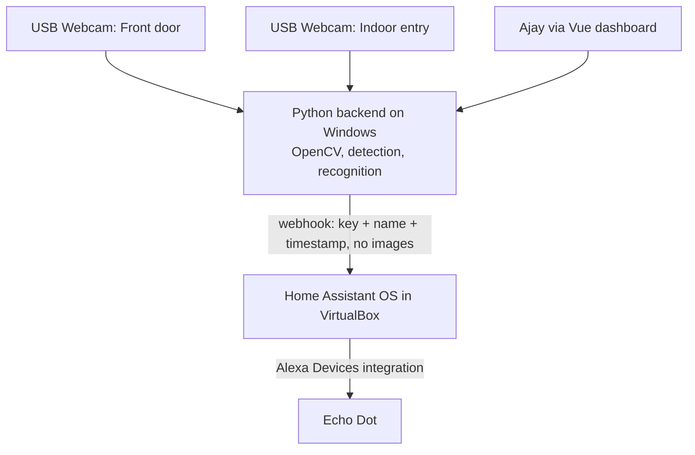

# AI Home Visitor Recognition & Welcome-Home System — Project Handbook

> **Purpose of this document:** Single source of truth for the AI Home Visitor Recognition & Welcome-Home System (`ai_webcam`) — goals, architecture, how to develop, deploy and operate it, and the full list of work remaining.
>
> **Conventions:** `TBD` = decision deliberately deferred (see §14 and the milestone it is tied to). Nothing marked TBD should be assumed. Facts here come from `README.md` and `docs/` as of 2026-10-17.

|                           |                                                                                         |
| ------------------------- | --------------------------------------------------------------------------------------- |
| **Project Name**    | AI Home Visitor Recognition & Welcome-Home System (`ai_webcam`)                         |
| **Version**         | 0.2.0 (feature-complete software; hardware verification pending)                        |
| **Status**          | Software built and tested; awaiting owner's hardware setup (recorder, HA VM, Echo Dot)   |
| **Last Updated**    | 2026-10-17                                                                              |
| **Document Owner**  | Ajay Singh (talktechwithajay) — ajaysingh002@gmail.com                                  |
| **Repository**      | `git@github-ttwa:talktechwithajay/ai_webcam.git` (personal account only)                |
| **Confidentiality** | Private / personal (handles biometric data — see §12)                                   |

---

## Table of Contents

1. [Project Overview](#1-project-overview)
2. [Stakeholders &amp; Team](#2-stakeholders--team)
3. [Requirements &amp; Scope](#3-requirements--scope)
4. [Architecture](#4-architecture)
5. [Tech Stack &amp; Dependencies](#5-tech-stack--dependencies)
6. [Getting Started (Development Setup)](#6-getting-started-development-setup)
7. [Development Guidelines](#7-development-guidelines)
8. [Testing &amp; Quality Assurance](#8-testing--quality-assurance)
9. [Build &amp; Deployment](#9-build--deployment)
10. [Environments](#10-environments)
11. [Operations &amp; Monitoring](#11-operations--monitoring)
12. [Security &amp; Compliance](#12-security--compliance)
13. [Project Management &amp; Processes](#13-project-management--processes)
14. [Risks &amp; Decisions](#14-risks--decisions)
15. [Support &amp; Maintenance](#15-support--maintenance)
16. [Glossary](#16-glossary)
17. [Appendix &amp; References](#17-appendix--references)
18. [Change Log](#18-change-log)
19. [Master To-Do List](#19-master-to-do-list)

---

## 1. Project Overview

### 1.1 Summary

A privacy-first, locally processed home visitor announcement system. Two USB webcams (front door, indoor entry) are read by a Python/OpenCV backend on a Windows 11 laptop. When a person is detected, the backend decides — locally — whether they are an **enrolled** person (someone who has voluntarily given consent) or **unknown**, and sends a small structured event to a Home Assistant (HAOS in VirtualBox) webhook. Home Assistant picks a message from its own fixed templates and speaks it on an Echo Dot via the Alexa Devices integration (e.g., "Aryan is at the door", "Welcome home").

A browser dashboard shows a filterable visitor log (known and unknown) with a captured picture and timestamp per person. Unknown visitors at the front door are saved as `UNKNOWN` and can be named later, which turns them into known people. The indoor camera supports per-person custom messages (e.g., "Welcome Naresh, today please make Aloo Paratha!") and per-person or global announcement mute.

Key privacy rule: **Home Assistant never performs recognition and never receives images.** Only event metadata (message key, sanitised name, owner-authored text, timestamp) leaves the Python app. Pictures and face templates (including those of unknown front-door visitors) stay on the laptop, encrypted at rest, with a retention policy.

### 1.2 Goals & Objectives

- **Goal 1:** Announce known visitors/family at the front door on the Echo Dot within a few seconds of detection (target latency TBD at M5, measured).
- **Goal 2:** Play a "welcome home" message when an enrolled person enters (indoor-entry state machine, M6).
- **Goal 3:** Keep all images and face templates on the laptop — encrypted at rest, with defined retention, never sent to the cloud or to HA.
- **Goal 4:** Keep false-recognition rate low and *measured* (evaluation on real enrolled data at M4 before any announcement is trusted).
- **Goal 5:** Run unattended and reliably (auto-start, reconnect on camera loss, no spam via cooldowns, quiet hours).
- **Goal 6:** Give the owner a browser dashboard to review every visitor (date filter, picture, timestamp), name unknown visitors, and manage indoor messages and mutes.
- **Goal 7:** Work end to end after the owner fills in a single git-ignored config file with Amazon/HA details.

### 1.3 Non-Goals / Out of Scope

- Identifying anyone by name who has not been enrolled or named by the owner. Unknown front-door visitors are stored as `UNKNOWN` (picture + template for grouping) until the owner names them; they are never identified automatically.
- Cloud processing of video or faces; no sending images to HA or any third party.
- Remote (off-LAN) dashboard access in v1.
- Door lock / access control — announcements are informational only, never a security decision.
- Mobile app, remote (off-LAN) access, multi-home support.
- Home Assistant doing detection or recognition.

### 1.4 Key Milestones

| Milestone | Description                                                                                              | Target Date | Status                                      |
| --------- | -------------------------------------------------------------------------------------------------------- | ----------- | ------------------------------------------- |
| M1        | Environment + Alexa test (HAOS VM, Alexa Devices, webhook automation, camera discovery)                  | TBD         | **In progress** — scaffolding done, gate not met |
| M2        | Camera capture + dashboard skeleton (FastAPI backend, Vue 3 frontend, test-video mode, auto-reconnect) | TBD         | **Built, tests pass; hardware check pending** |
| M3        | Person detection, zones, cooldown, dry-run mode | TBD         | **Built, tests pass; hardware check pending** |
| M4        | Enrollment, encrypted templates, matching, measured evaluation | TBD         | **Built, tests pass; hardware check pending** |
| M5        | Front-door announcements via HA (quiet hours, stale-event expiry) | TBD         | **Built, tests pass; hardware check pending** |
| M6        | Indoor entry state machine + welcome message | TBD         | **Built, tests pass; hardware check pending** |
| M7        | Reliability, security, retention, startup automation | TBD         | **Built, tests pass; hardware check pending** |
| M8        | Final docs and release checklist                                                                         | TBD         | Planned                                     |

---

## 2. Stakeholders & Team

### 2.1 Stakeholders

| Name       | Role                              | Responsibility                                  | Contact                    |
| ---------- | --------------------------------- | ----------------------------------------------- | -------------------------- |
| Ajay Singh | Product owner / sponsor / user    | Priorities, hardware, acceptance, manual steps   | ajaysingh002@gmail.com     |
| Household members | Subjects / end users       | Consent to enrollment; feedback on announcements | In person                  |

### 2.2 Development Team

| Name       | Role                       | Focus Area                              | Contact                |
| ---------- | -------------------------- | --------------------------------------- | ---------------------- |
| Ajay Singh | Owner, hardware, HA admin  | Manual setup, testing, decisions         | ajaysingh002@gmail.com |
| Claude Code | AI pair-programmer        | Code, scripts, docs, tests, reviews      | In-session             |

### 2.3 RACI Matrix

| Activity                         | Ajay | Claude |
| -------------------------------- | ---- | ------ |
| Requirements & priorities        | A/R  | C      |
| Code & docs                      | A    | R      |
| Hardware, HA, Amazon account     | A/R  | C      |
| Enrollment consent & data policy | A/R  | I      |
| Licence / model selection        | A    | R      |

---

## 3. Requirements & Scope

### 3.1 Functional Requirements

| ID    | Requirement                                                                                  | Priority | Status |
| ----- | -------------------------------------------------------------------------------------------- | -------- | ------ |
| FR-01 | Discover and identify both USB webcams (front-door vs indoor), re-runnable diagnostic        | Must     | Tooling done, not yet run |
| FR-02 | Echo Dot speaks a test message from HA (M1 gate)                                             | Must     | Open   |
| FR-03 | Send validated webhook events to HA with closed-vocabulary `message_key` and sanitised names | Must     | Done (tool); HA side untested |
| FR-04 | Backend captures both cameras, exposes status + MJPEG preview, auto-reconnects               | Must     | Built + automated tests; needs hardware check |
| FR-05 | Test-video mode that works without hardware                                                  | Should   | Built + tested (image/video file source) |
| FR-06 | Dashboard (Vue 3) shows camera status                                                        | Should   | Done (browser-verified) |
| FR-07 | Person detection with configurable zones, cooldown and dry-run mode                          | Must     | Built + automated tests; needs hardware check |
| FR-08 | Consent-based enrollment of people; encrypted face templates                                 | Must     | Built + automated tests; needs hardware check |
| FR-09 | Match enrolled people; everyone else is "unknown"; evaluated with measured metrics           | Must     | Built; accuracy NOT yet measured on real data |
| FR-10 | Front-door announcements with quiet hours and stale-event expiry                             | Must     | Built + automated tests; needs hardware check |
| FR-11 | Indoor entry state machine and welcome-home message                                          | Should   | Built + automated tests; needs hardware check |
| FR-12 | Delete a person's data on request; retention policy enforced                                 | Must     | Done (tests) |
| FR-13 | Auto-start on boot (VM + backend), health reporting                                          | Must     | Built (`install-startup.ps1`); not yet run on boot |
| FR-14 | Browser dashboard with a date filter (from/to, presets like Today) listing all visitors, known and unknown, each with timestamp, camera, name/`UNKNOWN` label and captured picture | Must | Done (browser-verified) |
| FR-15 | One log entry per person: if several people appear together, each gets a separate entry and picture (crop) | Must | Done (tests) |
| FR-16 | Front camera saves a picture of every unknown visitor, labelled `UNKNOWN` (not announced by name) | Must | Done (real-model test) |
| FR-17 | Dashboard lets the owner enter a name for an `UNKNOWN` visitor later; the name is saved and **automatically applied to all past visits** of that person (and future ones). Naming enrolls them, with the owner confirming consent. Renaming later also updates all visits | Must | Done (tests + browser) |
| FR-18 | Dashboard view listing all distinct unknown people noticed by the front camera (grouped by face similarity, with visit counts, first/last seen, thumbnail), with merge/split/name/delete actions | Must | Done (browser-verified) |
| FR-19 | Indoor camera: owner can define custom messages per person (e.g., Naresh → "Welcome Naresh, today please make Aloo Paratha!"), optionally with validity dates or a weekday schedule, and a default welcome fallback | Must | Done (tests) |
| FR-20 | Indoor camera: per-person mute and global mute of announcements from the dashboard (persisted; recognition and logging continue while muted) | Must | Done (tests) |
| FR-21 | Single git-ignored config file (`config/settings.local.yaml` or `.env`) holds Amazon/HA details; app runs end to end once filled; `check-config` command validates it | Must | Done; HA/Amazon linking is manual (see §14.2) |
| FR-22 | Delete visitor pictures/entries from the dashboard individually, by date range, or per person; retention auto-purge for `UNKNOWN` pictures | Must | Done (tests) |
| FR-23 | **Settings page** in the web app with a retention setting for `UNKNOWN` pictures: choose a number of days (default **90**) or **Never delete**. Change takes effect at the next daily purge; the page shows the next purge time and how many pictures would be deleted | Must | Done (tests + browser) |
| FR-25 | **CP Plus CCTV (DVR/NVR) support.** Each logical camera (front door, indoor) can be a USB webcam *or* a channel on the owner's CP Plus recorder, selected in the config file (recorder IP, port, username, password, channel numbers). Uses RTSP over TCP with a configurable URL template (default Dahua-style, see ADR-008); a lower-resolution substream is used for continuous detection and the main stream for the saved picture. A `check-cameras` command connects to each configured channel, reports success/failure with a clear reason, and saves a test snapshot | Must | Built; **untested on a real CP Plus recorder** |
| FR-26 | Recorder streams are resilient: auto-reconnect with backoff, always process the latest frame (no growing lag), stale-frame detection, and recorder credentials never logged or shown in the dashboard (URLs are masked) | Must | Built (reconnect tested only against a dead host) |
| FR-24 | **Visitors page** listing every unique visitor (known and unknown people, one row each: thumbnail, name/`UNKNOWN #n`, visit count, first seen, last seen). Selecting a visitor opens a detail view with a clean, sortable, paginated table of all past visits (date/time, camera, picture, match confidence, announced / muted / not announced), filterable by date range | Must | Done (browser-verified) |

### 3.2 Non-Functional Requirements

| ID     | Category        | Requirement                                                                  |
| ------ | --------------- | ---------------------------------------------------------------------------- |
| NFR-01 | Performance     | Detection-to-speech latency target TBD (measure at M5); runs on CPU of Core Ultra 9 185H |
| NFR-02 | Availability    | Unattended operation; recovers from camera unplug, HA restart, laptop reboot |
| NFR-03 | Privacy         | No images leave the laptop; stored pictures and face templates (incl. `UNKNOWN`) encrypted at rest; dashboard LAN-only and password-protected |
| NFR-04 | Accuracy        | False-accept rate target set and verified on real data before M5 enablement  |
| NFR-05 | Safety of speech| HA speaks only its own templates; names sanitised; the only free text spoken is owner-authored custom messages (length-limited, character-filtered), never text derived from visitors |
| NFR-07 | Usability       | Dashboard works in a modern desktop/mobile browser on the LAN; visitor list loads quickly with thumbnails and pagination |
| NFR-06 | Portability     | Python 3.12 venv; reproducible install from `requirements*.txt`             |

### 3.3 Assumptions & Constraints

- Host is a single Windows 11 Home laptop (31.5 GB RAM), kept plugged in and awake.
- Home Assistant OS runs in VirtualBox, bridged network; cameras stay on Windows (no USB passthrough).
- Hyper-V/VBS is active, so HAOS in VirtualBox may be slow; Hyper-V is the fallback.
- Amazon account needs authenticator-app 2FA (SMS unsupported) for the Alexa Devices integration.
- Amazon details are supplied by the owner later in a git-ignored config file. Home Assistant's Alexa Devices integration is normally configured in the HA UI, so the project provides a setup helper/guide and a config check; whether config-file credentials can be pushed to HA automatically is an open question (§14.2). Credentials are never committed.
- Camera source is now the owner's **CP Plus CCTV system via DVR/NVR** (reachable on the home LAN from the laptop); USB webcams are optional/fallback. This removes the "plug in two USB webcams" blocker. Image quality, camera angle and face size at the door still decide recognition accuracy.
- Analog cameras on a DVR (vs IP cameras on an NVR) can have low resolution; face recognition from small faces may need the main stream and a camera close to the entry. Evaluated at M4.
- Model and licence choices are not made yet (M3/M4).

---

## 4. Architecture

### 4.1 System Context



### 4.2 High-Level Architecture

Local-first, two-process design: a Python backend (capture, detect, recognise, decide) and a Home Assistant VM that only turns events into speech.

| Component              | Responsibility                                                        | Technology                      |
| ---------------------- | --------------------------------------------------------------------- | ------------------------------- |
| Capture service        | Read cameras (CP Plus DVR/NVR over RTSP, or USB), latest-frame reader thread, reconnect, test-video mode | Python 3.12, OpenCV (FFmpeg) |
| Detection / recognition| Person + face detection, zones, cooldown, matching enrolled people    | TBD (chosen at M3/M4)           |
| Decision / state logic | Front-door announce rules, indoor-entry state machine, dry-run        | Python                          |
| Backend API            | Camera status, MJPEG preview, enrollment, settings                    | FastAPI 0.143, uvicorn          |
| Dashboard              | Status, enrollment UI, settings, event log                            | Vue 3 (planned)                 |
| Secure store           | Encrypted face templates, retention                                   | TBD (M4)                        |
| Home Assistant         | Webhook automation → pick template → speak                            | HAOS, YAML automation           |
| Echo Dot               | Speak/announce                                                        | Alexa Devices integration       |

### 4.3 Data Model

Planned (finalised at M4): `Person` (id, display name or `UNKNOWN`, status enrolled/unknown, consent record/date, muted flag), `Template` (encrypted embedding, created date), `Visit` (id, one per person per appearance, camera, timestamp, person_id, match confidence, encrypted face-crop path, announced yes/no/muted), `UnknownCluster` (groups of similar `UNKNOWN` visits, counts, first/last seen), `CustomMessage` (person_id, text, optional start/end date or weekdays, enabled), `Settings` (camera indices, zones, cooldowns, quiet hours, global mute). Pictures are stored as encrypted face/person crops under a git-ignored `data/` folder, not as raw full frames, unless the owner opts in.

### 4.4 Interfaces & APIs

| Interface              | Type              | Direction | Documentation                                         |
| ---------------------- | ----------------- | --------- | ----------------------------------------------------- |
| HA webhook             | HTTP POST (JSON)  | Outbound  | `homeassistant/automation_visitor_announce.yaml`, `tools/test_announcement.py` |
| Backend REST + MJPEG   | HTTP              | Inbound (LAN) | `backend/ahv/api.py`                             |
| Alexa Devices          | HA integration    | Via HA    | https://www.home-assistant.io/integrations/alexa_devices/ |

### 4.5 Architecture Decision Records (ADRs)

> Store in `docs/adr/`.

| ID      | Decision                                                          | Date       | Status   |
| ------- | ----------------------------------------------------------------- | ---------- | -------- |
| ADR-001 | Recognition runs only in the Python app; HA gets events, never images | 2026-10-11 | Accepted |
| ADR-002 | HA speaks only its own templates selected by closed-vocabulary `message_key`. **Amended 2026-10-17:** adds `custom_message` key carrying owner-authored text from the dashboard (length-limited, filtered); no visitor-derived text | 2026-10-11 | Accepted (amended) |
| ADR-008 | Use the CP Plus DVR/NVR as the camera source over **RTSP (TCP) via OpenCV/FFmpeg**, with a config-driven URL template. CP Plus recorders are generally Dahua OEMs, so the default is `rtsp://USER:PASS@IP:554/cam/realmonitor?channel=N&subtype=S` (subtype 0 = main, 1 = sub). Passwords are percent-encoded. Fallbacks, in order: alternative URL templates in config → ONVIF stream discovery → HTTP `snapshot.cgi` polling (digest auth). Dahua-OEM status and exact URL are **unverified for the owner's model** until `check-cameras` succeeds | 2026-10-17 | Accepted (implemented) |
| ADR-006 | `UNKNOWN` front-door visitors are stored (picture + encrypted template) for review/naming, with retention; replaces earlier "don't store unknown faces" | 2026-10-17 | Accepted (implemented) |
| ADR-007 | Dashboard served by the FastAPI backend (Vue 3 SPA), LAN-only with login; images served only to authenticated sessions | 2026-10-17 | Accepted (implemented) |
| ADR-003 | Target Python 3.12 (wider CV wheel support) alongside installed 3.13 | 2026-10-11 | Accepted |
| ADR-004 | HAOS in VirtualBox (Hyper-V fallback)                              | 2026-10-11 | Proposed — pending performance check |
| ADR-005 | Face models: **YuNet** (detection, MIT) + **SFace** (128-d embeddings, Apache-2.0) from OpenCV Zoo, run via OpenCV DNN on CPU; checksum-pinned download. Accuracy still to be measured on the owner's footage | 2026-10-17 | Accepted |

---

## 5. Tech Stack & Dependencies

### 5.1 Technologies

| Layer          | Technology                       | Version        | Notes                                  |
| -------------- | -------------------------------- | -------------- | -------------------------------------- |
| Language       | Python                           | 3.12 (target)  | 3.13.1 installed; 3.12.10 via winget   |
| Capture        | OpenCV (FFmpeg backend)          | 4.14           | RTSP/TCP, USB, files                   |
| Backend        | FastAPI + SQLite + Fernet crypto | 0.143          | Single process, threads per camera     |
| Frontend       | Vue 3 + Vue Router + Vite        | 3.5 / 5.4      | Built to frontend/dist, served by backend |
| Automation     | Home Assistant OS                | latest stable  | In VirtualBox                          |
| Virtualization | VirtualBox                       | 7.x            | Not installed yet                      |
| Scripts        | PowerShell                       | 5.1            | Windows tooling                        |
| Models         | YuNet + SFace (OpenCV Zoo)       | 2023mar / 2021dec | `tools/download_models.py`          |

### 5.2 Key External Dependencies & Services

| Service                 | Purpose                    | Owner / Account | Criticality |
| ----------------------- | -------------------------- | --------------- | ----------- |
| Amazon account + Echo Dot | Speech output            | Ajay            | High        |
| Home Assistant Alexa Devices | Bridge to Echo        | HA project      | High        |
| GitHub (talktechwithajay) | Source hosting           | Ajay            | Low         |

### 5.3 Licenses

Face-detection/recognition models and datasets often carry non-commercial or restrictive licences. Verify each before adoption (M3/M4) and record in this section.

---

## 6. Getting Started (Development Setup)

### 6.1 Prerequisites

- Windows 11, kept plugged in
- Python 3.12, Git, Node (LTS or current), VS Code
- VirtualBox (installed from an **admin** PowerShell)
- Two USB webcams, Echo Dot, Amazon account with authenticator-app 2FA

### 6.2 Local Setup

```powershell
# 0. Inspect host
powershell -ExecutionPolicy Bypass -File scripts\check-environment.ps1

# 1. Prerequisites (VirtualBox needs an elevated shell)
powershell -ExecutionPolicy Bypass -File scripts\install-prerequisites.ps1
powershell -ExecutionPolicy Bypass -File scripts\install-prerequisites.ps1 -IncludeVirtualBox

# 2. Venv (new terminal)
py -3.12 -m venv .venv
.\.venv\Scripts\Activate.ps1
python -m pip install --upgrade pip
pip install -r requirements-tools.txt

# 3. Config
copy .env.example .env      # then fill values (see 6.3)

# 4. Keep Windows awake
powershell -ExecutionPolicy Bypass -File scripts\prevent-sleep.ps1

# 5. Cameras
python tools\list_cameras.py --snapshots

# 6. Webhook test
python tools\test_announcement.py --generate-id
python tools\test_announcement.py --dry-run
python tools\test_announcement.py
```

Home Assistant VM and Alexa steps: `docs/01-windows-setup.md` and `docs/02-home-assistant-alexa.md`.

### 6.3 Configuration & Environment Variables

| Variable         | Description                                   | Example                          | Required |
| ---------------- | --------------------------------------------- | -------------------------------- | -------- |
| `HA_BASE_URL`    | Home Assistant LAN base URL                   | `http://homeassistant.local:8123`| Yes      |
| `HA_WEBHOOK_ID`  | Random webhook ID (generate with the tool)    | *(generated)*                    | Yes      |
| Recorder (config file, M2) | `host`, `rtsp_port` (554), `username`, `password`, per-camera `channel` and `subtype`, optional `rtsp_url_template` | `192.168.1.108`, channel `1` | Yes (if using CP Plus) |

> The recorder password lives only in the git-ignored local config. Use a dedicated **read-only/view-only** recorder user for this system, not the admin account.

> **Secrets:** Never commit `.env`. Amazon/HA credentials are entered only in the HA UI, never in this repo. `.gitignore` blocks secrets and biometric data.

### 6.4 Common Issues (Troubleshooting Setup)

| Problem                             | Solution                                                               |
| ----------------------------------- | ---------------------------------------------------------------------- |
| HAOS slow/unstable in VirtualBox    | Hyper-V/VBS active; fall back to Hyper-V Manager with `.vhdx` image    |
| `homeassistant.local` not resolving | Use the VM's IP in `HA_BASE_URL`                                       |
| Webhook HTTP 404                    | Wrong webhook ID or automation disabled                                |
| Trace stops at condition            | Quiet hours, event >60 s old (clock skew), or unknown `message_key`    |
| No speech but trace succeeded       | Wrong notify entity, Echo offline, Amazon rate limiting                |
| Alexa login fails                   | Non-app 2FA or bad credentials                                         |
| Camera indices change               | Expected; re-run `list_cameras.py`, indices are stored in config       |

---

## 7. Development Guidelines

### 7.1 Repository Structure

```text
.
├── backend/ahv/       # config, crypto, db, camera, faces, pipeline, announce, api, runtime, CLI (__main__)
├── backend/tests/     # pytest suite (53 tests)
├── frontend/          # Vue 3 dashboard (src/views: Visits, Visitors, VisitorDetail, Unknown, Messages, Announcements, Cameras, Settings)
├── config/            # settings.example.yaml (copy to settings.local.yaml, git-ignored)
├── homeassistant/     # automation YAML (placeholders only)
├── tools/             # download_models.py, test_announcement.py, list_cameras.py
├── scripts/           # setup, run, install-startup, prevent-sleep, check-environment, install-prerequisites
├── docs/              # 01–04 guides, milestone reports
├── models/ data/      # git-ignored: face models; DB, encrypted pictures, secret.key
└── requirements.txt
```

### 7.2 Branching & Git Workflow

- **Main branch:** `main`
- **Feature branches:** `m<N>/<short-description>`
- **Commit convention:** imperative summary, e.g. `Add Milestone 1 scaffolding: ...`
- **Remote:** must use the `github-ttwa` SSH alias. Never push to or reference `ajaymediastra` or `Growth-Catalysts`.

### 7.3 Code Review & Pull Requests

- Self-review plus Claude `/code-review` before merging to `main`.
- Each PR states the milestone, what was tested, and what was *not* tested.

### 7.4 Coding Standards

- **Python:** type hints, `ruff` + formatter (to be configured at M2), stdlib-first for tools.
- **Privacy rules in code:** never log images, embeddings, or secrets; names pass through the sanitiser.
- **Docs:** every milestone ends with a report in `docs/` stating real test results honestly.

### 7.5 Definition of Done

- [ ] Code implemented and reviewed
- [ ] Tests written and passing (with what-was-actually-run stated)
- [ ] Docs and this handbook updated
- [ ] Milestone acceptance criteria met on real hardware where applicable
- [ ] No secrets, images or templates in git

---

## 8. Testing & Quality Assurance

### 8.1 Test Strategy

| Test Level         | Scope                                               | Tooling              | Who / When          |
| ------------------ | --------------------------------------------------- | -------------------- | ------------------- |
| Unit tests         | Payload validation, sanitiser, cooldown, state machine | pytest (M2+)      | Every change        |
| Integration        | Backend ↔ HA webhook, camera reconnect               | pytest + test video  | Per milestone       |
| Template test      | Jinja in HA automation                               | HA Developer Tools   | M1 (pending)        |
| Recognition eval   | FAR/FRR on real enrolled data, varied light/angles   | Custom eval script   | M4 gate             |
| Soak test          | Days of unattended running, camera unplug, reboot    | Manual + logs        | M7                  |
| Security           | Secrets scan, dependency audit, data-at-rest check   | gitleaks/pip-audit   | M7                  |

### 8.2 Running Tests

```powershell
python tools\test_announcement.py --dry-run     # offline payload validation
# pytest — added in M2
```

### 8.3 Quality Gates & Coverage

- M1 gate: Echo Dot speaks the test message.
- M4 gate: measured false-accept rate within agreed target before announcements use recognition.
- No unverified claims in milestone reports.

---

## 9. Build & Deployment

### 9.1 CI/CD Pipeline

None yet. Optional at M7/M8: GitHub Actions for lint + unit tests (no hardware tests).

### 9.2 Release Process

- **Versioning:** SemVer; `1.0.0` at M8.
- **Release checklist:** produced at M8 (hardware, privacy, backup, startup verification).
- **Changelog:** see §18 (handbook) and git tags.

### 9.3 Rollback Procedure

1. `git checkout <previous-tag>` and restart the backend.
2. HA: restore the previous automation from HA's automation history/backup.
3. Verify with `tools\test_announcement.py` and a live walk-through.

---

## 10. Environments

| Environment | Purpose                    | URL                         | Deployed From | Access  |
| ----------- | -------------------------- | --------------------------- | ------------- | ------- |
| Local (only)| Dev and production, same laptop | `localhost`, HA `:8123` | `main`        | Ajay    |
| Test-video  | Hardware-free testing (M2) | `localhost`                 | `main`        | Ajay    |

> Single-machine system: there is no separate staging. Use dry-run mode (M3) and test-video mode to avoid live announcements while developing.

---

## 11. Operations & Monitoring

### 11.1 Runbook Basics

| Task                 | How                                              | Link/Command |
| -------------------- | ------------------------------------------------ | ------------ |
| Start HA VM          | VirtualBox UI or `VBoxManage startvm "Home Assistant" --type headless` | M7 automates |
| Check HA automation  | HA → Automations → Traces                        | —            |
| Find camera indices  | `python tools\list_cameras.py --snapshots`       | —            |
| Test speech path     | `python tools\test_announcement.py`              | —            |
| Keep awake           | `scripts\prevent-sleep.ps1` (`-Restore 30` to undo) | —         |

### 11.2 Monitoring & Alerting

To define at M7: camera up/down, HA reachable, last-event age, disk usage, backend heartbeat, with a health message through HA (health messages bypass quiet hours).

### 11.3 Incident Management

Personal system: Ajay is the sole responder. On a misidentification, disable announcements (dry-run), record the case, add to evaluation set, and review thresholds.

### 11.4 Backup & Recovery

- **Back up:** settings, encrypted templates, HA backup, `.env` (stored separately, securely).
- **Restore procedure / RTO / RPO:** TBD at M7.
- Delete `data\camera_probe\` snapshots after use (personal data).

---

## 12. Security & Compliance

### 12.1 Authentication & Authorization

- HA: owner account with a strong unique password (never used by this app).
- Backend/dashboard: LAN-only; authentication added by M7. HA webhook is `local_only`, POST only, with a random ID.

### 12.2 Data Protection & Privacy

- Face data is biometric: enrol only people who give explicit consent; record consent.
- Unknown front-door visitors' pictures are stored (owner's explicit requirement) as `UNKNOWN`, encrypted, with an owner-set auto-purge retention period (default 90 days, or never) and manual delete. Pictures of people who have been named are not purged by this setting. Naming an unknown person is the owner's assertion that they consent or that the owner accepts responsibility.
- Indoor-camera mismatches are logged as `UNKNOWN` only if the owner enables it (setting).
- Retention and deletion-on-request policy defined by M4/M7.
- Post a camera notice where legally required (check local rules).
- Visitors/guests: consider local notice/legal requirements for cameras and biometrics (check local law).

### 12.3 Secrets Management

- `.env` is git-ignored; credentials live only in the HA UI. Rotate the webhook ID if exposed.

### 12.4 Security Practices

- Dependency pinning and audit; secrets scan before commits; `.gitignore` blocks `.env`, `data/`, templates.
- Encrypted-at-rest templates; key storage approach decided at M4 (e.g., Windows DPAPI).

---

## 13. Project Management & Processes

### 13.1 Way of Working

- **Methodology:** Milestone-based, solo with AI pair-programming.
- **Tracking:** this handbook's §19 and per-milestone reports in `docs/`.

### 13.2 Meetings & Rituals

None. At the end of each milestone: write a report, record manual actions, decide on the next gate.

### 13.3 Communication Channels

In-session with Claude Code; GitHub repo for artifacts.

### 13.4 Reporting

`docs/milestone-N-report.md` — honest status, tests really run, manual actions, next acceptance criteria.

---

## 14. Risks & Decisions

### 14.1 Risk Register

| ID   | Risk                                                          | Probability | Impact | Mitigation                                                   | Owner |
| ---- | ------------------------------------------------------------- | ----------- | ------ | ------------------------------------------------------------ | ----- |
| R-01 | HAOS in VirtualBox slow/unstable under Hyper-V/VBS            | Medium      | Medium | Hyper-V fallback; don't disable VBS                          | Ajay  |
| R-02 | Misidentification announces wrong name                        | Medium      | High   | Measured eval, conservative threshold, "unknown" default, dry-run | Both |
| R-03 | Biometric data leak                                           | Low         | High   | Encryption, local-only, `.gitignore`, retention policy       | Ajay  |
| R-04 | Alexa integration breaks (Amazon changes/rate limits)         | Medium      | Medium | Health message, fallback speech path (TBD)                   | Ajay  |
| R-05 | Camera index drift after reboot/replug                        | High        | Medium | Re-runnable diagnostic; match by device identity where possible | Both |
| R-06 | Model licences unsuitable                                     | Medium      | Medium | Verify licences before adoption                              | Claude |
| R-07 | Laptop sleep/reboot stops the system                          | Medium      | Medium | `prevent-sleep.ps1`, startup tasks (M7)                      | Ajay  |
| R-08 | Poor lighting/angles reduce accuracy                          | High        | Medium | Evaluate on real door footage; adjust placement              | Ajay  |
| R-09 | Jinja templates in HA YAML untested                           | High (now)  | Low    | Test in HA at M1                                             | Both  |
| R-14 | CP Plus model/firmware uses a different RTSP path, limits concurrent streams, or blocks access (RTSP disabled, different port, fixed channel offsets) | Medium | Medium | Configurable URL template, `check-cameras` diagnostic, ONVIF/snapshot fallbacks, test with VLC first | Both |
| R-15 | Recorder streams add latency or use H.265 that OpenCV build can't decode | Medium | Medium | Use substream for detection; set recorder to H.264 if needed; verify decode in `check-cameras` | Both |
| R-10 | Stored unknown-visitor pictures raise privacy/legal exposure   | Medium      | High   | Encryption, retention purge, login-protected dashboard, LAN-only | Ajay  |
| R-11 | Unknown-clustering merges different people or splits one       | High        | Low    | Owner merge/split tools; conservative clustering thresholds  | Both  |
| R-12 | Custom spoken text could be abused/mis-sent                    | Low         | Medium | Owner-only authoring, length/character limits, dashboard auth | Both  |
| R-13 | Amazon credentials in a config file get leaked                 | Low         | High   | Git-ignored file, restricted permissions, prefer HA UI entry | Ajay  |

### 14.2 Open Questions

| Question                                              | Raised By | Date       | Status |
| ----------------------------------------------------- | --------- | ---------- | ------ |
| Which detection/recognition models and licences?       | Claude    | 2026-10-11 | Open (M3/M4) |
| Acceptable false-accept target?                        | Claude    | 2026-10-17 | Open   |
| How to key camera identity (index vs device ID)?       | Claude    | 2026-10-17 | Open (M2) |
| Key management for template encryption?                | Claude    | 2026-10-17 | Open (M4) |
| Retention period for events/templates?                 | Claude    | 2026-10-17 | Open   |
| Guest notice / legal requirements for biometrics?      | Claude    | 2026-10-17 | Open   |
| Can Amazon credentials live in a config file and be applied to HA automatically, or must they be entered in HA's UI (Alexa Devices)? Fallback: a helper script + guide that reads the config and walks through it | Claude | 2026-10-17 | Open (investigate at M5) |
| Recorder details needed from owner: DVR or NVR? exact CP Plus model, LAN IP, RTSP port, which channel numbers are front door and indoor, video codec (H.264/H.265), whether a view-only user can be created | Claude | 2026-10-17 | Open — owner to supply |
| Retention period for `UNKNOWN` pictures (e.g., 30/90 days)? | Claude | 2026-10-17 | **Closed:** default 90 days, owner-configurable in Settings, or never delete (FR-23) |
| Should a named unknown visitor's past visits be relabelled automatically? | Claude | 2026-10-17 | **Closed:** yes, always (owner decision, FR-17) |

---

## 15. Support & Maintenance

- **Support contact:** Ajay Singh
- **Maintenance:** monthly check — HA updates, Alexa integration status, Windows updates (prevent unexpected reboots), dependency audit
- **End-of-life:** delete all templates and snapshots, remove HA automation and Amazon integration

---

## 16. Glossary

| Term       | Definition                                                         |
| ---------- | ------------------------------------------------------------------ |
| HA / HAOS  | Home Assistant / Home Assistant Operating System                   |
| Webhook    | HTTP endpoint in HA that triggers the announce automation          |
| `message_key` | Closed-vocabulary key selecting an HA-owned message template    |
| Enrolled   | A person who has voluntarily consented and has a stored template   |
| Template (face) | Numeric embedding of an enrolled face — never the image       |
| Dry-run    | Mode that logs decisions without sending announcements             |
| Cooldown   | Minimum time before the same person/event may be announced again   |
| Zone       | Region of the camera frame where detections count                  |
| FAR / FRR  | False-accept / false-reject rate                                   |
| VBS        | Virtualization-based security (Windows)                            |
| ADR        | Architecture Decision Record                                       |

---

## 17. Appendix & References

- HA Windows install: https://www.home-assistant.io/installation/windows
- Alexa Devices integration: https://www.home-assistant.io/integrations/alexa_devices/
- `docs/01-windows-setup.md`, `docs/02-home-assistant-alexa.md`, `docs/milestone-1-report.md`
- `homeassistant/automation_visitor_announce.yaml`

---

## 18. Change Log

| Date       | Version | Author               | Change                                                    |
| ---------- | ------- | -------------------- | --------------------------------------------------------- |
| 2026-10-17 | 1.0     | Ajay Singh / Claude  | Filled handbook from project intent; added master to-do list |
| 2026-10-17 | 1.1     | Ajay Singh / Claude  | Added dashboard, unknown-visitor storage/naming, per-person indoor messages and mutes, config-file credentials (FR-14–FR-22, ADR-006/007, R-10–R-13) |
| 2026-10-17 | 2.0     | Ajay Singh / Claude  | Implementation complete: statuses, ADR-005..008 accepted, repo structure, to-do list rewritten |
| 2026-10-17 | 1.3     | Ajay Singh / Claude  | Added CP Plus DVR/NVR as camera source via RTSP (FR-25, FR-26, ADR-008, R-14, R-15); USB webcams now optional |
| 2026-10-17 | 1.2     | Ajay Singh / Claude  | Added Settings page with retention (90 days default / never), rename-all-past-visits on naming, Visitors page with per-visitor visit table (FR-17, FR-23, FR-24) |

---

## 19. Master To-Do List

> Legend: ✅ done and verified · 🟡 built and unit-tested, needs verification on your hardware · ⬜ not started · 🧑 manual action by Ajay

### Software (all built; tests: 53 passing; dashboard checked in a browser; face models run on sample images)
- ✅ Config system, `check-config`, git-ignored `config/settings.local.yaml`, secrets masked in logs (FR-21)
- ✅ Encrypted storage (pictures, thumbnails, embeddings), SQLite, retention purge, delete actions (FR-12, FR-22)
- ✅ Face detection + embedding (YuNet/SFace), matcher, tracker (min frames, best-frame pick), zones, cooldowns
- ✅ One visit per person; unknown people saved as `UNKNOWN #n`; naming renames all past visits (FR-15–FR-17)
- ✅ Dashboard: Visits (date filter), Visitors (+ per-visitor table, add from photos), Unknown people, Indoor messages, Announcements/mutes, Cameras, Settings (retention 90 days / never) (FR-14, FR-18–FR-20, FR-23, FR-24)
- ✅ Announcement logic: front-door known/unknown, indoor custom message or welcome, per-person and global mute, quiet hours, dry-run, async delivery
- ✅ HA automation updated for `custom_message`; `test_announcement.py` supports it
- ✅ Scripts: `setup.ps1` (verified end to end), `run.ps1`, `install-startup.ps1` (syntax-checked only)
- 🟡 RTSP source for CP Plus recorder + `check-cameras` (failure path verified against an unreachable host; success path needs your recorder) (FR-25, FR-26)
- 🟡 Full-resolution grab on confirmed face (`snapshot_subtype`): logic unit-tested with a fake; real recorder untested

### Your manual steps (nothing below can be done by code)
1. 🧑 Fill `config/settings.local.yaml`: dashboard password, recorder IP/user/password (view-only user), channel numbers
2. 🧑 `scripts\run.ps1 check-cameras`: fix URL/channel/codec until both cameras show OK with faces detected
3. 🧑 Install VirtualBox, build the Home Assistant VM, add Alexa Devices (authenticator-app 2FA), make the Echo speak (M1 gate; see docs 01 and 02)
4. 🧑 Paste the updated automation into HA, set `home_assistant.enabled: true` and the webhook ID in your settings file
5. 🧑 Start in dry-run; watch Visits for a few days; then tick "Send real announcements" in Settings
6. 🧑 Name unknown people / add Naresh etc. with consent; add indoor messages
7. 🧑 Measure real accuracy (walk-ups by household members at the real door in day and night light); adjust `match_threshold` / camera angle
8. 🧑 Enable BitLocker, back up `data/secret.key` separately from `data/`, run `scripts\install-startup.ps1`, `scripts\prevent-sleep.ps1`
9. 🧑 Soak test several days (reboot, unplug a camera, restart HA)

### Not built / future ideas
- ⬜ Automatic Amazon-credential injection into Home Assistant (HA's Alexa integration must be linked in HA's UI)
- ⬜ Accuracy evaluation harness with labelled footage (current thresholds are defaults, unmeasured)
- ⬜ Liveness / spoof detection (a photo held to the camera could be recognised)
- ⬜ HTTPS for the dashboard (LAN HTTP only; keep it off the internet)
- ⬜ Optional CI (lint + tests)
- ⬜ ONVIF / `snapshot.cgi` fallbacks for recorders where RTSP does not work
- ⬜ Update §1.4 target dates when you set a schedule; tag `v1.0.0` after the hardware steps above
